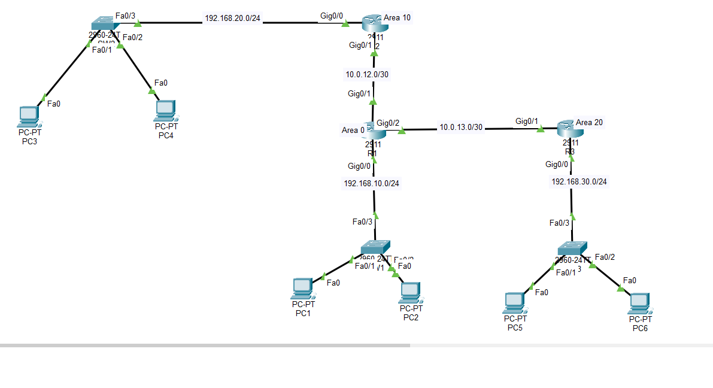

# Multi-Area OSPF Network Design & Implementation

A Cisco Packet Tracer project demonstrating multi-area OSPF configuration, route propagation, neighbor adjacency verification, and end-to-end connectivity across three LANs.

## Project Overview

This network uses a hub-and-spoke topology with three Cisco 2911 routers. OSPF Area 0 is the backbone, connecting two additional areas:

- **Area 0:** R1 LAN and the point-to-point links between routers.
- **Area 10:** R2 LAN.
- **Area 20:** R3 LAN.

R2 and R3 act as Area Border Routers (ABRs), connecting their respective non-backbone areas to Area 0. OSPF dynamically exchanges routing information so hosts in different LANs can communicate without static routes.

## Topology

- 3 × Cisco 2911 routers (R1, R2, R3)
- 3 × Cisco 2960 switches (SW1, SW2, SW3)
- 6 × PCs (2 per LAN)
- 2 × point-to-point router links using /30 subnets



## IP Addressing

### LAN and WAN Networks

| Segment | Network | OSPF Area |
|---|---|---|
| R1 LAN | 192.168.10.0/24 | Area 0 |
| R2 LAN | 192.168.20.0/24 | Area 10 |
| R3 LAN | 192.168.30.0/24 | Area 20 |
| R1–R2 link | 10.0.12.0/30 | Area 0 |
| R1–R3 link | 10.0.13.0/30 | Area 0 |

### Router Interface Addressing

| Router | Interface | IP Address |
|---|---|---|
| R1 | G0/0 | 192.168.10.1/24 |
| R1 | G0/1 | 10.0.12.1/30 |
| R1 | G0/2 | 10.0.13.1/30 |
| R2 | G0/0 | 192.168.20.1/24 |
| R2 | G0/1 | 10.0.12.2/30 |
| R3 | G0/0 | 192.168.30.1/24 |
| R3 | G0/1 | 10.0.13.2/30 |

## OSPF Design

OSPF Process ID: **1**

| Router | Router ID | OSPF Networks / Areas |
|---|---|---|
| R1 | 1.1.1.1 | R1 LAN and both router links — Area 0 |
| R2 | 2.2.2.2 | R1–R2 link — Area 0; R2 LAN — Area 10 |
| R3 | 3.3.3.3 | R1–R3 link — Area 0; R3 LAN — Area 20 |

**ABRs:** R2 and R3 each connect Area 0 to a non-backbone area.

## Key Technologies and Concepts

- Cisco Packet Tracer and Cisco IOS CLI
- OSPFv2 dynamic routing
- Multi-area OSPF and backbone Area 0
- Router IDs and OSPF neighbor adjacencies
- Area Border Routers (ABRs)
- Inter-area route advertisement
- IPv4 addressing, subnetting, and /30 point-to-point links
- Routing table interpretation

## Configuration and Verification

The network was configured and tested using Cisco IOS CLI commands.

Useful verification commands:

```text
show ip interface brief
show ip ospf
show ip ospf neighbor
show ip route ospf
show ip route
```

### Verification Results

- R1 established OSPF neighbor adjacencies with R2 and R3.
- Both neighbors reached the **FULL** state.
- OSPF-learned routes were present in the routers' routing tables.
- Inter-area routes appeared with the **O IA** route code.
- Cross-LAN connectivity was tested successfully between PCs on different LANs.

### OSPF Neighbor and Routing Table — R1


### OSPF Routing Table — R2


### OSPF Routing Table — R3


### End-to-End Connectivity Tests

**PC1:** Successful connectivity tests to hosts in the R2 and R3 LANs.


**PC3:** Successful connectivity test to a host in the R3 LAN.


## Project Files

- `Multi_Area_OSPF_Network_Design.pkt` — Cisco Packet Tracer simulation file.
- `README.md` — Project documentation.
- PNG files in the repository root — topology and configuration/verification evidence.

## Learning Outcomes

This project provided practical experience with multi-area OSPF design and configuration, ABR operation, neighbor adjacency verification, inter-area route analysis, and troubleshooting connectivity across routed LANs.

**Tools:** Cisco Packet Tracer | Cisco IOS CLI
